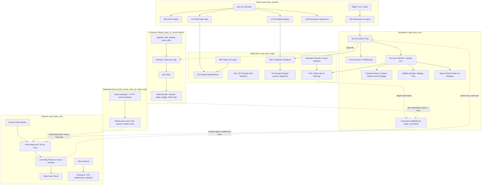

# Architecture and source tree

Where everything is in the repository, and how the code fits together. The game is a set of C++17 libraries (assets, simulation, network, computer players, control interface, dedicated server, application); the tree says what each folder holds, and the diagram shows how a command travels through the layers.

## Directory Structure

The root folder is `ants-cross-platform/`. A comment says what a folder or file is for; the file's own header comment says the rest. Counts of files and tests are not kept here, because they go stale; `./run_tests.sh` prints the tests' own.

```text
ants-cross-platform/
├── asset_catalog/                      # The "Sprites and sounds" page: every sprite, sound and animation of
│                                       # ants.chd (PLAY_IN_BROWSER.md, "Interactive Asset Catalog")
│   ├── index.html                      # Browser application for asset inspection
│   ├── catalog_data.js                 # Indexed metadata for sprites, audio clips, and animations
│   ├── sounds/                         # Decoded 91 WAV sound effects (IDs 0..90)
│   └── sprites/                        # Decoded 2,794 RGBA PNG sprites (IDs 0..2793)
├── cmake/                              # CMake helper scripts
│   ├── ants_stamp_build_id.cmake       # Writes the build id (the short git commit, or a given id) into
│   │                                   # ants::BUILD_ID at every build
│   └── ants_test_paths.cpp.in          # Template of the generated file that tells the tests where the checkout is
├── docker/                             # Container deployment configuration
│   ├── nginx.conf                      # nginx of the web image: game files revalidated (ETag, 304), cross-origin and
│   │                                   # WASM headers, routes to the game server
│   └── resolve_build_id.sh             # The build id of a Docker image build (a build argument, else the clone's git
│                                       # files, else the build time)
├── docs/                               # Guides, specifications and design notes
│   ├── PLAY_IN_BROWSER.md              # The web build as a player sees it: the front page, playing online and
│   │                                   # rejoining, sound, hidden tabs, the 16:9 picture
│   ├── GAMEPLAY.md                     # How the game plays: the data, the ants, movement, food, power-ups,
│   │                                   # abilities, combat, hills, end of match, fog
│   ├── CONTROLS.md                     # Start menu, setup screen, options, settings, mouse, touch, keyboard
│   ├── VIEW_AND_HUD.md                 # The picture, the view, zoom, the HUD, messages, results screen, audio
│   ├── TOUCH.md                        # Touch controls: what a finger does and how the model turns it into mouse
│   │                                   # events
│   ├── COMMAND_LINE.md                 # Every option of ants and the environment variables
│   ├── BUILD_AND_RUN.md                # Prerequisites, building (desktop and web), running, AddressSanitizer, the
│   │                                   # build id, Docker
│   ├── MULTIPLAYER.md                  # Network play and bots: a LAN, the game server and the browser, how a match
│   │                                   # runs, limits, the bots
│   ├── SERVER.md                       # The dedicated server: starting it, rooms, the control interface, public
│   │                                   # status, restart records, the Docker stack
│   ├── TESTING.md                      # Testing and CI
│   ├── ARCHITECTURE.md                 # This page: the source tree and the layers
│   ├── NETWORK_PORT.md                 # The network design in full: the original's network, the lock-step core,
│   │                                   # transports, the protocol by version, host migration, reconnect,
│   │                                   # restart records
│   ├── BOTS.md                         # Bots (computer players): the rule, fairness, architecture, difficulty
│   │                                   # levels, the standard bot, running bots, known limits
│   ├── WORKFLOW.md                     # How work flows: the three test tiers, branches and releases, the deploy, the
│   │                                   # version policy, the changelog template
│   ├── GAME_REVERSE_ENGINEERING.md     # The mechanics reference (ground truth per system)
│   ├── ORIGINAL_PROGRAM.md             # How the remake is tied to the original: what comes from it, where your own
│   │                                   # copy of the program goes, the tools and tests that read it
│   ├── chd_table4_animations.json      # Table 4 animations of ants.chd (generated by tools/dump_table4.py)
│   └── reverse_engineering/            # Verified reports on the original's ant movement (movement/)
├── include/                            # Public C++ headers
│   ├── ants_assets/                    # Archive and map readers, the map writer, the original-safe profile of the map
│   │                                   # checker, sprite and sound structs, mirroring, object footprints
│   ├── ants_sim/                       # Simulation engine, grid, ant units, command layer, state hash, the
│   │                                   # original's texts and movement tables
│   ├── ants_net/                       # Lock-step protocol, sequencer, runner, sessions, room, prediction, jitter
│   │                                   # buffer, the reconnect rules (turn log, attendance), TCP / WebSocket /
│   │                                   # loopback transports, LAN discovery
│   ├── ants_ai/                        # Computer players: Bot interface, view, map analysis, controller (budget,
│   │                                   # timing, HUD rules), idle bot, task model, worker bot, the standard bot
│   │                                   # (tasks, tactics, styles, teams), match runner, baselines
│   ├── ants_replay/                    # The replay file (.antsrep), the recorder that a game feeds and the player
│   │                                   # that plays a file out and lists its orders
│   ├── ants_db/                        # The game server's database: a thin wrapper over SQLite, schema migrations
│   ├── ants_ctl/                       # Strict JSON and the HTTP server of the game server's control interface (a
│   │                                   # bearer secret; a read-only door without one for the public replay list)
│   ├── ants_server/                    # The dedicated server: map store, rooms, the door, control calls, restart
│   │                                   # records, site statistics, the replay store
│   └── ants_app/                       # SDL2 application, renderer, HUD, audio mixer, MIDI, FPS overlay (and its
│                                       # ping / delay readout), start menu, touch controls, zoom, the MP3 decoder
│                                       # (dr_mp3.h), the version template (version.hpp.in: the build generates
│                                       # version.hpp from the file VERSION)
├── Original-Ants/                      # The data files that the game reads: the original's archive, maps and MIDI
│                                       # music, MP3 renders of that music, and a font (no program: see
│                                       # ORIGINAL_PROGRAM.md)
│   ├── ants.chd                        # The original's archive: sprites, sounds, palette, animations
│   ├── LibreFranklin-Medium.ttf        # Bundled text font, not from the original (Libre Franklin, SIL Open Font
│   │                                   # License)
│   ├── LibreFranklin-OFL.txt           # The licence of that font
│   ├── *.MID                           # The four pieces of music, as MIDI files
│   ├── *.mp3                           # MP3 renders of the four pieces: the game plays these
│   └── Maps/                           # Binary .LVL maps: the six of the original; every .lvl in this folder is
│                                       # listed on the setup screen
├── src/                                # Implementation source code
│   ├── ants_assets/                    # Reading ants.chd (header, palette, sprite, sound and animation tables),
│   │                                   # reading, writing and checking the .LVL maps (MAP_FORMAT.md), palette mapping, mirroring
│   ├── ants_sim/                       # Tick loop, PATHMGR A*, locomotion and action clips, combat, abilities,
│   │                                   # commands, state hash
│   ├── ants_net/                       # Network core (no threads, non-blocking sockets; the one call that can
│   │                                   # block is the name lookup in tcp.cpp, which the start menu runs on a worker thread
│   │                                   # and `ants --join NAME` on the game's own thread), TCP and LAN discovery, the
│   │                                   # WebSocket server (native) and the browser's WebSocket client (web)
│   ├── ants_ai/                        # Computer players (virtual clients; no SDL, no sockets, no threads)
│   ├── ants_replay/                    # The replay file, its recorder and its player (no SDL, no sockets)
│   ├── ants_db/                        # SQLite behind a thin wrapper, schema migrations (native only)
│   ├── ants_ctl/                       # JSON library and HTTP server (a bearer secret, or a read-only door)
│   ├── ants_server/                    # ants_server: the dedicated game server program (main.cpp; the rest is the
│   │                                   # library ants_server_core)
│   └── ants_app/                       # The program ants: windowing, input (mouse, keyboard, touch), the map view,
│                                       # rendering, HUD, audio, the start menu, setup, options and results screens
├── tests/                              # Automated verification test suites
│   ├── common/                         # Shared test code: where the checkout is (ants_test_paths.hpp), the short pause
│   │                                   # of the network tests' pump loops (ants_test_pause.hpp) and the pinned
│   │                                   # SHA-256 digests of the bytes of Ants.exe that suites 1.1 and 2.15 read
│   │                                   # (original_program_bytes.hpp)
│   ├── e2e/                            # Standalone opaque-box E2E test runner
│   ├── test_assets/                    # Binary asset parsing and movement-table parity tests
│   ├── test_sim/                       # Simulation rules, golden action suites, movement and pathfinding, command
│   │                                   # layer / state hash
│   ├── test_net/                       # Lock-step core, room, jitter buffer, prediction, TCP, WebSocket, LAN
│   │                                   # discovery and NetGame suites
│   ├── test_ai/                        # Computer players: the controller, the idle bot, bot seats in rooms, the
│   │                                   # view, the map analysis, the match runner; the worker bot and its pinned
│   │                                   # baselines; the standard bot (power-ups, walls, fights, raids, the gate,
│   │                                   # styles, teams, the contest play, the island play, the order of the
│   │                                   # tasks)
│   ├── test_ctl/                       # JSON library and control HTTP server suites
│   ├── test_db/                        # The database wrapper, the migrations and the server's schema (test_db)
│   ├── test_server/                    # Dedicated server suite (map store, rooms, the door, control calls, site
│   │                                   # statistics) and the way back of the game's NetGame (test_rejoin)
│   ├── test_app/                       # Application integration, render parity, HUD, status line, input, pointer,
│   │                                   # options, start menu, touch, zoom and widescreen suites
│   ├── scripts/                        # Shell and python suites; the test_web_*.sh scripts are opt-in browser checks
│   │                                   # of the web build (not part of run_tests.sh)
│   │   ├── test_start_game.sh          # The start script's dry run
│   │   ├── test_ants_server.sh         # The dedicated server end to end, with real programs
│   │   ├── flaky_proxy.py              # A TCP proxy that can be cut (for the server's reconnect checks)
│   │   ├── test_*.py                   # The python tests of the repository's tools and tiers (changelog page,
│   │   │                               # version tools, run_tests.sh --fast, CI workflow, nginx, deploy, release,
│   │   │                               # mutation, staging, the web pages)
│   │   ├── run_python_tests.py         # Runs those python tests side by side
│   │   ├── process_state.py            # Helper: whether a process still runs
│   │   ├── stack_command.py            # Helper: the server's command in docker-compose.stack.yml
│   │   ├── test_web_aspect.sh          # The picture's shape (the seven shapes), the dropdown, fullscreen, the pointer
│   │   ├── test_web_camera.sh          # The camera of a replay (Auto / Manual) with the real game, desktop and phone
│   │   ├── test_web_changelog.sh       # The changelog page's pages: tabs, addresses, Back and Forward, a phone, no JavaScript
│   │   ├── test_web_replay_lock.sh     # The mouse in the fullscreen of a replay (the pointer lock, the bar under it) with the real game
│   │   ├── test_web_replay_map.sh      # A replay that carries its map (tmap) in a real browser with the real game: no fetch of the map
│   │   ├── test_web_edge.sh            # The pointer of a fullscreen page (the bars, the pointer lock), the margin of
│   │   │                               # a windowed one
│   │   ├── test_web_hidden.sh          # The game in a hidden browser tab
│   │   ├── test_web_home.sh            # The front page: the lobby, START, the Menu, the old addresses
│   │   ├── test_web_live.sh            # Watching a live match: the list's box, the player, its cards (a fake door)
│   │   ├── test_web_prediction.sh      # The prediction of one's own orders, on and off, in two windows of a real
│   │   │                               # browser
│   │   ├── test_web_rejoin.sh          # The way back to a running match in two browsers: a reload, a server restart,
│   │   │                               # the front page's Rejoin button
│   │   ├── test_web_touch.sh           # The touch controls (tap, hold, drag, two-finger pan and pinch) with a
│   │   │                               # phone-like and an iPhone-like browser
│   │   └── web_*_check.*               # Helpers of the web checks: the pages' own code run under node, and the
│   │                                   # browser drivers
│   └── data/                           # Golden sample data (edge scrolling)
├── third_party/                        # Code that is not ours, built from source: sqlite/ (the SQLite amalgamation, public
│                                       # domain, with its README and its CMake target ants_sqlite)
├── tools/                              # Reverse-engineering, generator and release tools, and the headless programs
│                                       # that are built on request
│   ├── analyze_binary.py               # Capstone function map of Ants.exe (needs your own copy of the program)
│   ├── extract_movement_tables.py      # Movement tables from Ants.exe and ants.chd (needs your own copy of the
│   │                                   # program)
│   ├── movement_reference_model.py     # The golden movement timings (needs the same two files)
│   ├── dump_table4.py                  # Table 4 animations of ants.chd as JSON
│   ├── gen_food_footprints.cpp         # Writes src/ants_sim/food_footprints_data.inc from ants.chd
│   ├── map_sweep.cpp                   # The map sweep: plays every map of a folder headless (built on request:
│   │                                   # --target map_sweep)
│   ├── lvl_tool.cpp                    # The map file tool: checks (also for the original game), describes and rewrites
│   │                                   # .lvl files, makes a blank map (built on request: --target lvl_tool)
│   ├── bot_arena.cpp                   # The bot arena: headless matches of computer players (built on request:
│   │                                   # --target bot_arena)
│   ├── bench_aggressor.hpp             # Scripted aggressor bots to measure the standard bot against (arena and tests
│   │                                   # only)
│   ├── changelog_to_html.py            # Turns CHANGELOG.md into the site's /changelog.html
│   ├── check_version_consistency.py    # Checks that VERSION, CHANGELOG.md and README.md name the same
│   │                                   # release
│   ├── release.py                      # A release in one command: VERSION, the changelog's "## Next" heading, the
│   │                                   # README's version line (--dry-run, --open-pr)
│   ├── mutate.py                       # The mutation runner of the deep tier: one change at a time, always restored,
│   │                                   # baselines of the unmutated tree
│   ├── deploy_filter.py                # Does a push change what the images contain or the stack file? (the deploy
│   │                                   # job's file filter)
│   ├── deploy_wait.py                  # Waits until the game server is idle (GET /busy) before the deploy job
│   │                                   # restarts the site
│   ├── web_without_docker.py           # The web image without Docker (Linux): the Dockerfile's commands on
│   │                                   # this machine, the pages served with nginx, for the browser checks
│   ├── deploy_webhook.sh               # Calls the Portainer deploy webhook without ever printing its address
│   └── front_page_art/                 # Makes the front page's pictures in web/front/ from the game's own assets
│                                       # (needs Pillow; a developer's tool, in no build or test)
├── web/                                # The web build's page files
│   ├── shell.html                      # The game page in the front page's look (WebAssembly shell: loading screen,
│   │                                   # hidden-tab timer, sound unlock, the picture's box, touch guards)
│   ├── lobby.html                      # The front page: the lobby, a room on the game server (four colors,
│   │                                   # a code and link, the map, START), a code to join, rejoin a running match
│   ├── legal.html                      # The Legal page: free, no warranty, no liability, unofficial (static, in the changelog page's look)
│   ├── front/                          # The front page's pictures, rules and chat box (lobby_rules.js, lobby_net.js, lobby_chat.js and .css, map_picker.js and .css, game_modes.js and game_type.js and .css; art made by tools/front_page_art), its font Libre
│   │                                   # Franklin (SIL Open Font License, licence beside it) and classic.css, the
│   │                                   # look that the other pages link
│   ├── favicon.ico                     # Site icon
│   └── favicon.png                     # Site icon (PNG)
├── .github/
│   └── workflows/ci.yml                # Continuous integration (see TESTING.md)
├── .dockerignore                       # What stays out of the Docker build context
├── .editorconfig                       # Editor settings (UTF-8, LF, four spaces, no trailing blanks)
├── .gitattributes                      # Line endings of scripts, binary files, the original's data kept byte for
│                                       # byte
├── .gitignore                          # What stays out of the repository (build folders, local copies of the
│                                       # original program, per-user files)
├── README.md                           # The short front page; the details are in docs/
├── CHANGELOG.md                        # What changed in each release, a few lines each (also served at
│                                       # /changelog.html)
├── CMakeLists.txt                      # Root CMake build configuration
├── docker-compose.yml                  # The web game alone (service ants-beta); the whole site is
│                                       # docker-compose.stack.yml
├── docker-compose.server.yml           # Example service of the dedicated game server
├── docker-compose.stack.yml            # The web game and the game server together as one stack (Portainer,
│                                       # auto-deploy)
├── docker-compose.staging.yml          # The same two services as a second stack with its own names, ports, volumes
│                                       # and network, for trying finished work
├── Dockerfile                          # Multi-stage Emscripten + Nginx build
├── Dockerfile.server                   # The dedicated game server alone (no SDL, no sprites or sounds; it carries
│                                       # the six maps)
├── build_web.sh                        # Local WebAssembly build into dist/
├── run_tests.sh                        # Master test suite runner script
├── run_tests.bat                       # Windows runner (part of the suites only, see docs/BUILD_AND_RUN.md)
├── start_game.sh                       # One-click build and launch script (macOS / Linux)
├── start_game.bat                      # The same for Windows
├── LICENSE                             # MIT licence of the source code and the documents (the original's data is not
│                                       # covered)
├── THIRD_PARTY_NOTICES.md              # Third-party code and fonts in the repository or linked by the build, with
│                                       # their licences
├── VERSION                             # The one place the version is written (one line, MAJOR.MINOR.PATCH); the
│                                       # build generates the C++ header from it
└── AGENTS.md                           # Project rules for contributors and coding agents
```

- The six maps in `Original-Ants/Maps/` are the original's ([`GAME_REVERSE_ENGINEERING.md`](GAME_REVERSE_ENGINEERING.md) section 4: TREASURE, GAUNTLET, ISLANDS, MEDIUM, SMALL and TINY).
- The original program (`Ants.exe`) and its decompilation are not in the repository: [`ORIGINAL_PROGRAM.md`](ORIGINAL_PROGRAM.md) says where a local copy goes and which tools and tests use it.

## Architecture Overview

The code is split into nine layers: `ants_assets`, `ants_sim`, `ants_net`, `ants_ai`, `ants_replay`, `ants_db`, `ants_ctl`, `ants_server` and `ants_app`. Each has its own folder in `include/` and `src/` and is built as a static library (`libants_<name>.a`, or `ants_<name>.lib` with MSVC; the server's is `libants_server_core.a`). A layer uses only the layers listed before it. Two programs sit on top: the game (`ants`, from `ants_app`) and the dedicated server (`ants_server`). `ants_db`, `ants_ctl` and `ants_server` are native only; the web build compiles the other six layers with Emscripten.

A command is how a player or a bot changes the simulation. A local game applies it at once; in a network game the host's sequencer seals the commands of every 50 ms into a numbered turn, and every machine runs the same turns on the same tick. The state hash, reported every 20th turn (once a second), shows when a copy of the match goes its own way.



The big boxes are the layers. Solid arrows show what feeds what; dotted arrows are the links of a running match: commands going in, the same turns on every machine, a bot reading the world.

| Layer | What it holds | Where it runs |
|---|---|---|
| `ants_assets` | Readers for the archive `ants.chd` (palette, sprites, sounds, animations), the reader and the writer of the `.LVL` maps ([`MAP_FORMAT.md`](MAP_FORMAT.md)), sprite mirroring | Everywhere |
| `ants_sim` | The simulation: the tile grid, ants, movement and pathfinding, combat, abilities, food, power-ups, the 20 Hz tick, the command layer (`Command`, `apply_command`) and the state hash | Everywhere |
| `ants_net` | Lock-step play: the protocol, the host's sequencer, the runner, sessions, the room before a match, prediction of one's own orders, the jitter buffer, the reconnect rules, LAN discovery; transports for TCP, WebSocket and in-memory tests | Everywhere. TCP, LAN discovery and the WebSocket server are native only; the browser's WebSocket client is web only |
| `ants_ai` | Computer players as virtual clients: view, map analysis, controller (reaction delay, command budget), task model, worker bot, standard bot, match runner. No SDL, no sockets, no threads | Everywhere: in the game and in the server's rooms |
| `ants_replay` | The replay file (`.antsrep`), the recorder that a game or a room of the server feeds, and the player that plays a file out and lists its orders ([`REPLAYS.md`](REPLAYS.md)). No SDL, no sockets, no threads | Everywhere |
| `ants_db` | The game server's database: a thin C++17 wrapper over SQLite (`Database`, `Statement`, `Transaction`, the online backup, no exceptions) and the schema migrations. SQLite itself is vendored in `third_party/sqlite/` as the static library `ants_sqlite` ([`SERVER.md`](SERVER.md#the-database)). No SDL, no sockets, no threads | Native only |
| `ants_ctl` | Strict JSON and a small HTTP server: the control interface of the game server (a bearer secret), and a read-only door without one that the server opens for the public list of its replays | Native only |
| `ants_server` | The dedicated game server: map store, rooms (a referee per room that also runs the room's bots), the door, control calls, restart records, site statistics, the store of the replays of its rooms' matches, the schema of its database. The program `ants_server` is `main.cpp` plus the library `ants_server_core` | Native only |
| `ants_app` | The game: SDL2 window and main loop, renderer, HUD, audio mixer, start menu and the other screens, touch controls, zoom | Native and web |

`third_party/` holds code that is not ours and is built from source (SQLite today; the music decoder `dr_mp3.h` is in `include/ants_app/`). Two small libraries sit beside them: `ants_version` (the generated `ants_app/version.hpp` and `ants::BUILD_ID`, linked by the game and the server) and `ants_test_paths` (where the checkout is, for tests and tools).

### Lookups in the tick loop

The tick asks six questions thousands of times, and none looks at every ant any more (as scans they made a map of thousands of ants cost about the square of its ants). Each gives exactly the answer of the scan it replaced, so no tick changes by a bit:

- **The ant of an id** (`SimulationEngineImpl::find_unit`). Ants are never removed and an id is `next_ant_id_++` at the push_back (both restart at 1 in `init`), so ant n sits in slot n - 1. The slot is checked, and a miss (an id never handed out, a table that stopped being dense) falls back to the scan. Id 0 is no ant (ids start at 1, nothing else makes one) and answers nullptr at once.
- **Whether an ant has a path request queued** (`PathManager::has_request_for`, and the replacement of an ant's first request in `request`). A byte for each ant id (a larger id is counted and scanned) changes with every push, pop and clear of the queue and is rebuilt from the queue after a copy. It is derived data: never copied, not in the state hash, so a copy of the engine (prediction) cannot carry a stale flag.
- **The ants on a tile** (`TileAntIndex`, `src/ants_sim/tile_ants.hpp`; asked by `occ_scan`, which `occ_move` and `occupant_at` call on a tile that holds several ants, and by `blast`, both in `occupancy.cpp`). For every cell of the occupancy grid, a list of the ants whose `occ_tile` is that cell, linked through the table of ants by slot (4 bytes a cell, 8 an ant, adding and removing O(1)). `occ_move` is the only place that writes `occ_tile` (and `occ_refresh`, which starts the lists again when the grid has another size), so a spawn, a hatch, a step, a knock-back, a landing and a death keep the lists right without a line of their own. They are derived data, not in the state hash and never sent; a copy of the engine copies them with the ants (a slot is a place in the copied table). A list has no order of its own: `occ_scan` takes the first ant in the order (team, slot) of the scan as the least of that key, and the last ant that stands without a path as the greatest, and `blast` sorts the slots, so each answer is the scan's. A tile off the grid has no list and takes the scan.
- **The ants that an order's refresh has to put right** (`occ_refresh_for_order`, `occupancy.cpp`; asked by `go_to`, which used to start with `occ_refresh()`, a walk over every ant: a live ant that is not registered on its pixel tile is registered there, a removed ant that is still registered is unregistered, any other ant is left alone). In a tick `go_to` visits only the ants that are marked: a bit for each slot of the table (`occ_dirty_`) that `occ_note` sets when an ant is out of step and clears when it is not. It runs at the end of `occ_move` (the one writer of `occ_tile`, so after `set_position` and every step), after `remove_ant` writes `removed`, and in `add_ant` (the one place that adds an ant). The marked ants are visited in the order of the table and each gets the walk's own rule (`occ_refresh_ant`), so the moves happen in the order the walk made them: the same grid, lists and ants. The marks are for the tick: `movement_tick` starts with the full walk (which empties them) and holds `occ_in_tick_` until it ends; outside a tick (commands, `stop_ant`, a test that moves or kills an ant by hand between two ticks) and in the engine of the scans alone `go_to` takes the full walk, so such a write is put right as before, and the public `occ_refresh()` stays the full walk. Derived data: never hashed or sent, copied with the ants, emptied by a new match.
- **The tiles that team-mates claim** (`order_claims.cpp`; asked by `can_enter`, rule R6, for every goal and ring tile that `adjust_goal` tries). An ant claims a tile while it is not removed and has a Move or Home order to it. For every cell of the grid a list (the `TileAntIndex` class again, `claim_ants_`) holds the ants that claim it, and `claimed_by_mate` looks at the list of the tile (a handful of ants) for another ant of the asker's team, where the scan looked at every ant. The lists are exact, not healed by the question: every write of an order goes through `set_order_kind`, `set_order_tile` or `clear_path_of`, the only writers (`tests/scripts/test_order_writers.py` fails for a direct write in the sources), a removal and `add_ant` note the ant too, and each `claim_note` puts the ant in the list its order says. Outside a tick `can_enter` scans; in a tick it asks the lists, after `movement_tick` has started by putting every ant right (`claims_catch_up_all`, the net for a test that pokes an order through `get_unit()` between two ticks: the shadow build stops at anything it has to put right in a match). Derived data: not hashed or sent, copied with the ants, made again for a grid of another size, emptied by a new match. `claimed_by_mate_scan` is the old scan.
- **The next timed event of an ant** (`AntEventHeap`, `src/ants_sim/event_heap.hpp`, `event_queue.cpp`; asked by `movement_tick` before each event). An ant has four events with a due time in its own fields: the end of the burn overlay (`burn_end_ms`), the combat timer (`combevt_due_ms`), the end of the animation frame (`loco.next_ms`) and the end of a pause (`pause_fire_ms`). The tick runs the earliest due at or before its end; ties go to the ant earlier in the table, then to the earlier of those four kinds, and a task (anthill queue, hatching, flower droppers) goes first only when strictly earlier. The heap is ordered by that key (time, slot, kind), so its first entry is the scan's answer. It is a binary heap with lazy deletion: each (ant, kind) has a record (pending, due time, version), `AntEventHeap::set` is the only writer and pushes an entry when an event becomes pending or its time changes, and an entry whose version is not its record's is dead and is thrown away when it reaches the top. `event_refresh` writes an ant's four records from its fields and follows every write of those fields (the sites are listed at the top of `event_queue.cpp`). The pass over every ant at the start of a tick (`event_catch_up`) is the net under the writers, and also what keeps right a write from OUTSIDE the tree: a test hook that pokes an ant's fields through `get_unit()` between two ticks (no production code does) gives the heap no word, and without the pass the engine plays such a poke differently from the scans. The shadow build stops at anything the pass has to put right in a match and counts it in the two tests that write from outside on purpose; `test_engine_event_heal` plays such writes in the product build against an engine that is told. It is derived data: not hashed, never sent, copied with the ants, emptied by a new match. `next_ant_event_scan` is the old scan.

`test_engine_lookups` ([`TESTING.md`](TESTING.md)) links `ants_sim_shadow`, the same sources compiled with `ANTS_SIM_LOOKUP_SHADOW` (no product build has it): every call also runs the scan (every 64th once the table or the queue holds more than 256; every blast) and stops the program on a difference, every list is rebuilt from the ants and compared at the end of a tick (every 16th once big) and after every copy of an engine, every selection of the next event is compared with the scan and the whole heap with the ants' fields at the start and end of every tick and after every copy, every refresh of marked ants is played again from the same state by the full walk and compared (grid, lists, every ant), every ant out of step must be marked at the end of every tick, every claims question is compared with the scan (every call up to 2,048 ants) and the lists with the ants' orders at the end of a tick and after a copy, and each match is played twice, with the scans alone and with the lookups, the state hash compared at every tick. A new index of this kind keeps its scan beside it and joins that check.

Where to read more:

- The turns, the sequencer, the runner and the sessions: [`NETWORK_PORT.md`](NETWORK_PORT.md#the-lock-step-core-srcants_net-v0044) ("The lock-step core"); network play for players: [`MULTIPLAYER.md`](MULTIPLAYER.md).
- The bots: [`BOTS.md`](BOTS.md#architecture) ("Architecture").
- The rules that `ants_sim` implements: [`GAMEPLAY.md`](GAMEPLAY.md); the original's mechanics, system by system: [`GAME_REVERSE_ENGINEERING.md`](GAME_REVERSE_ENGINEERING.md).
- The picture, the view and the HUD: [`VIEW_AND_HUD.md`](VIEW_AND_HUD.md).
- The dedicated server and its control interface: [`SERVER.md`](SERVER.md).
- The tests: `tests/` has one folder for each layer (see the tree above); [`TESTING.md`](TESTING.md) describes the suites by number, the three tiers and CI.
